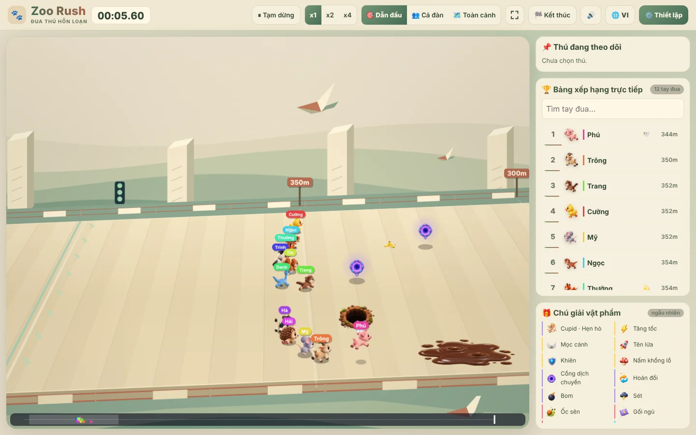
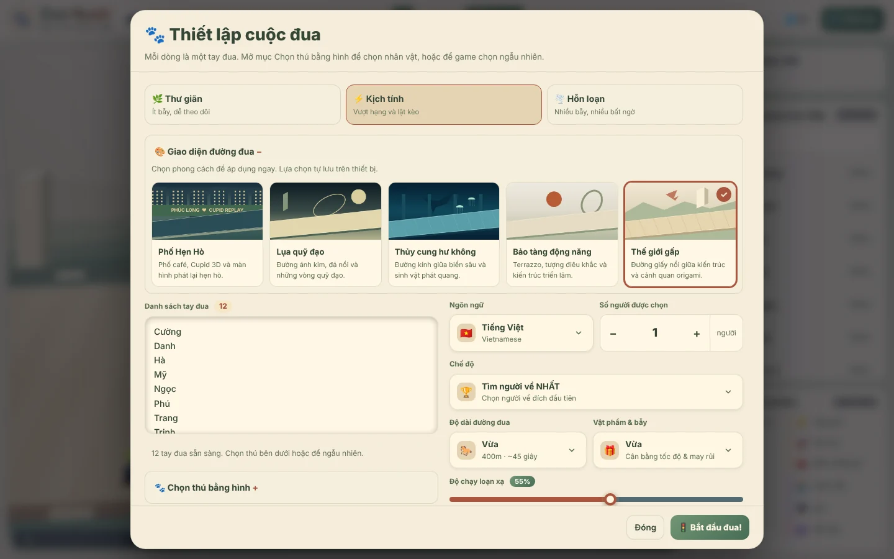
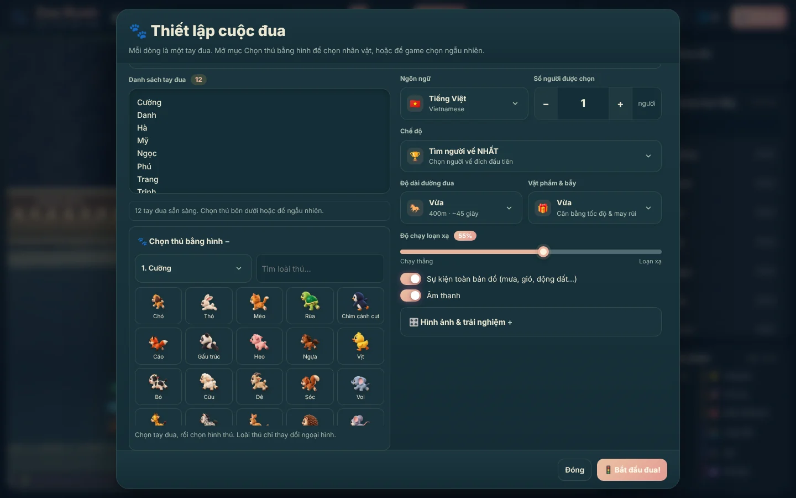
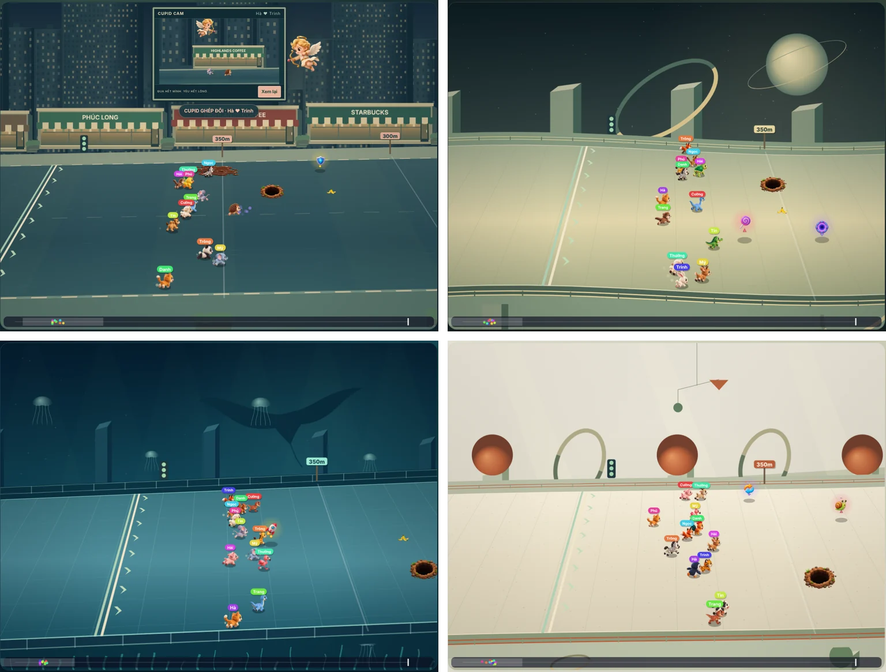
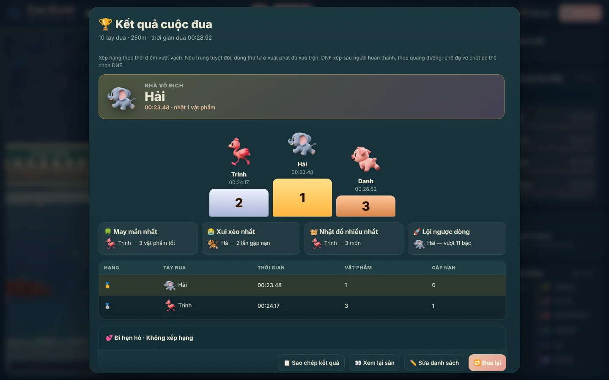
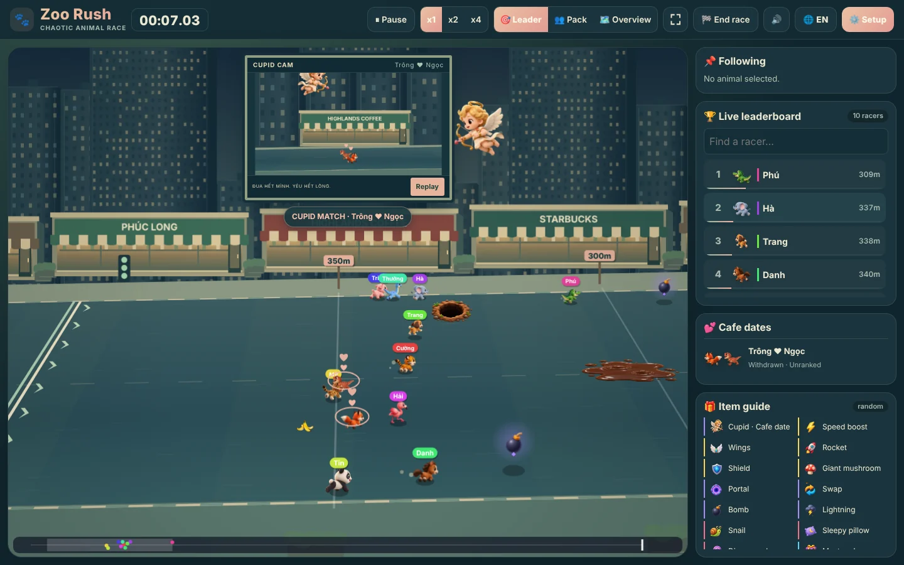
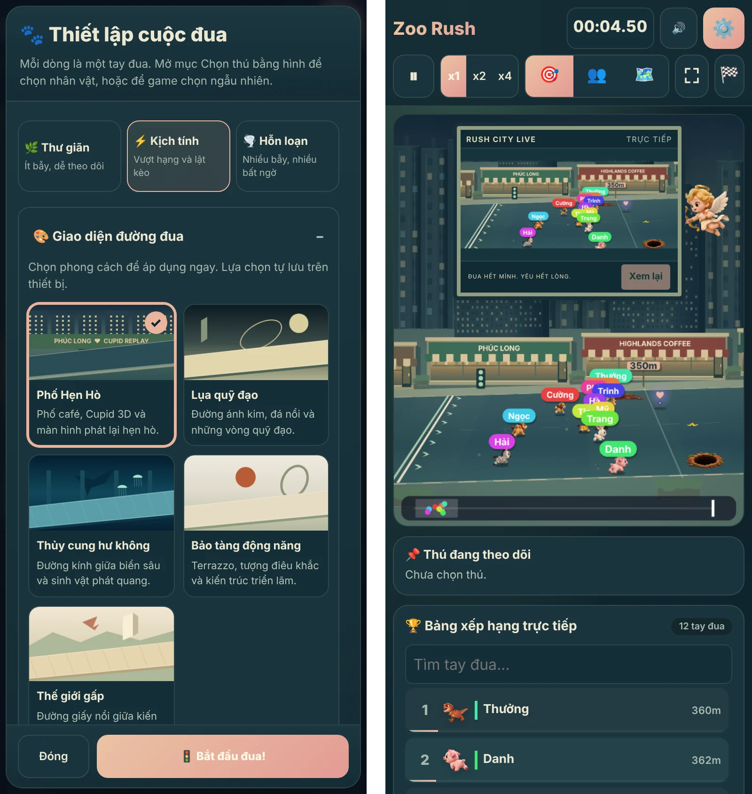

<h1 align="center">🐾 PaNIC Zoo Rush</h1>

  Nhập tên mọi người, mỗi người thành một chú thú, rồi để cuộc đua hỗn loạn quyết định ai về nhất, hay ai về chót. 
  Cách bốc thăm vui nhất cho buổi họp nhóm, lớp học hay bữa tiệc.

  <a href="https://panic-zoo-rush.vercel.app/"><b>Chơi ngay →</b></a>
  &nbsp;·&nbsp; Miễn phí &nbsp;·&nbsp; Không cần tài khoản &nbsp;·&nbsp; Chạy trên máy tính và điện thoại

---

## Dành cho ai?

Khi cần chọn ngẫu nhiên một người (ai lên thuyết trình trước, ai trả tiền cà phê, ai nhận phần quà), thay vì quay số khô khan, hãy cho cả nhóm cùng xem một cuộc đua thú. Mỗi người là một tay đua, ai cũng có cơ hội, và không ai biết trước kết quả cho tới vạch đích.

## Mục lục

- [Thiết lập cuộc đua trong một phút](#thiết-lập-cuộc-đua-trong-một-phút)
- [Chọn thú cho từng người](#chọn-thú-cho-từng-người)
- [Năm đường đua, năm thế giới](#năm-đường-đua-năm-thế-giới)
- [Vật phẩm, bẫy và sự kiện bất ngờ](#vật-phẩm-bẫy-và-sự-kiện-bất-ngờ)
- [Theo dõi cuộc đua](#theo-dõi-cuộc-đua)
- [Kết quả và danh hiệu](#kết-quả-và-danh-hiệu)
- [Tiếng Việt và tiếng Anh](#tiếng-việt-và-tiếng-anh)
- [Trên điện thoại](#trên-điện-thoại)

---

## Thiết lập cuộc đua trong một phút

Dán danh sách tên, mỗi dòng một người, rồi bấm **🚦 Bắt đầu đua!**. Muốn chỉnh thêm thì có đủ lựa chọn:

- **Cấu hình nhanh**: 🌿 *Thư giãn* (ít bẫy, dễ theo dõi), ⚡ *Kịch tính* (vượt hạng và lật kèo), 🌪️ *Hỗn loạn* (nhiều bẫy, nhiều bất ngờ).
- **Chế độ**: tìm người về **NHẤT** hoặc tìm người về **CHÓT**, và chọn **số người được chọn** (ví dụ lấy 3 người về chót).
- **Độ dài đường đua**: Ngắn khoảng 30 giây, Vừa khoảng 45 giây, Dài khoảng 70 giây, Siêu dài khoảng 100 giây.
- **Vật phẩm và bẫy**: từ *Ít* (thuần tốc độ) tới *Hỗn loạn* (bom, sét, hố khắp nơi).
- **Độ chạy loạn xạ**: kéo từ *chạy thẳng* tới *loạn xạ*.
- **Sự kiện toàn bản đồ** và **âm thanh**: bật hoặc tắt.

Các nút **🔀 Xáo trộn**, **✨ Danh sách mẫu**, **🗑️ Xóa hết** giúp chuẩn bị danh sách nhanh hơn. Lựa chọn của bạn được nhớ cho lần chơi sau.

## Chọn thú cho từng người

Mở **🐾 Chọn thú bằng hình** để gán cho mỗi người một chú thú: chó, mèo, rùa, cáo, gấu trúc, heo, ngựa, voi, hồng hạc… Tìm nhanh theo tên loài, hoặc để game chọn ngẫu nhiên. Loài thú chỉ thay đổi ngoại hình, nên không ai được lợi thế.

## Năm đường đua, năm thế giới

| Đường đua | Không khí |
|---|---|
| **Thế giới gấp** | Đường giấy nổi giữa núi đồi và chim hạc origami · *mặc định* |
| **Phố Hẹn Hò** | Phố café, thần Cupid và màn hình lớn phát lại khoảnh khắc hẹn hò |
| **Lụa quỹ đạo** | Đường ánh kim giữa đá nổi và những vòng quỹ đạo |
| **Thủy cung hư không** | Đường kính giữa biển sâu, sứa và sinh vật phát quang |
| **Bảo tàng động năng** | Sàn terrazzo, tượng điêu khắc và kiến trúc triển lãm |

Mặc định là **Thế giới gấp**. Chọn đường đua khác ngay trong màn hình thiết lập, thay đổi được áp dụng lập tức và được nhớ cho lần sau.

Phố Hẹn Hò · Lụa quỹ đạo · Thủy cung hư không · Bảo tàng động năng

## Vật phẩm, bẫy và sự kiện bất ngờ

Đường đua rải đầy hộp quà bí ẩn, và mỗi món có thể lật ngược cục diện:

- **Giúp sức**: ⚡ tăng tốc, 🕊️ mọc cánh, 🚀 tên lửa, 🛡️ khiên chặn đòn, 🍄 nấm hoá khổng lồ, 🌀 cổng dịch chuyển.
- **Phá đám**: 🔀 tráo vị trí với người khác, 💣 bom, ⛈️ sét đánh người dẫn đầu, 🍌 vỏ chuối, 🐌 ốc sên, 😴 gối ngủ, 🍭 kẹo chóng mặt, 🕳️ hố.
- **Sự kiện toàn bản đồ**: 🌧️ mưa lớn làm cả đàn chậm lại, 🍃 gió xuôi, 🌋 động đất mở hố mới, 🎉 mưa vật phẩm.
- **Hẹn hò**: ở Phố Hẹn Hò, thần Cupid có thể ghép đôi hai tay đua, cả hai rủ nhau rời cuộc đua đi café 💕.

Thú còn húc nhau, giành đồ, đè bẹp nhau khi hoá khổng lồ, nên chẳng cuộc đua nào giống cuộc đua nào.

## Theo dõi cuộc đua

- **Bảng xếp hạng trực tiếp**: thứ hạng và quãng đường của từng người, có ô tìm tên.
- **Camera**: 🎯 bám người dẫn đầu, 👥 bám cả đàn, hoặc 🗺️ xem toàn cảnh. Chạm vào một chú thú để theo dõi riêng.
- **Tốc độ**: xem ở x1, x2 hoặc x4, tạm dừng bất cứ lúc nào, hoặc bấm **🏁 Kết thúc** để chốt sớm.
- **Chú giải vật phẩm** ngay bên cạnh, để ai mới chơi cũng hiểu chuyện gì đang xảy ra.

## Kết quả và danh hiệu

Kết thúc cuộc đua là bục vinh quang cho top 3, kèm bảng xếp hạng đầy đủ với thời gian, số vật phẩm nhặt được và số lần gặp nạn. Thêm bốn danh hiệu vui: 🍀 **May mắn nhất**, 😭 **Xui xẻo nhất**, 🧺 **Nhặt đồ nhiều nhất** và 🚀 **Lội ngược dòng**.

Bấm **📋 Sao chép kết quả** để dán vào nhóm chat, **👀 Xem lại sân**, **✏️ Sửa danh sách**, hoặc **🔁 Đua lại** ngay.

## Tiếng Việt và tiếng Anh

Chuyển ngôn ngữ bằng nút 🌐. Toàn bộ giao diện, thông báo trong cuộc đua và bảng kết quả đều đổi theo.

## Trên điện thoại

Giao diện tự sắp xếp lại cho màn hình nhỏ: sân đua ở trên, bảng xếp hạng ở dưới, các nút điều khiển gọn trên một hàng. Máy yếu thì chọn chất lượng hình ảnh *Thấp*, hoặc bật **Giảm chuyển động & tắt rung**.

---

## Phím tắt

| Phím | Tác dụng |
|---|---|
| `Space` | Tạm dừng / tiếp tục |
| `1` `2` `3` | Tốc độ x1 / x2 / x4 |
| `C` | Đổi chế độ camera |

## Lưu ý

Mỗi cuộc đua là một lần bốc thăm mới: loài thú chỉ thay đổi ngoại hình, còn vị trí xuất phát được xáo trộn ngẫu nhiên. Danh sách tên và lựa chọn chỉ được lưu trên trình duyệt của bạn.

Made with ❤️ by <a href="https://github.com/mdev-qn95">mdev-qn95</a>

